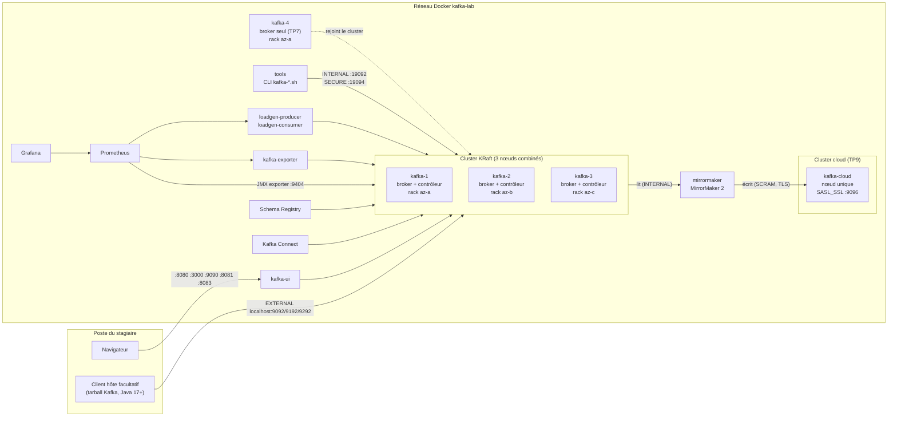
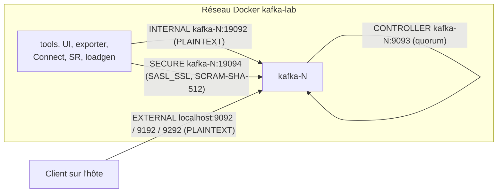
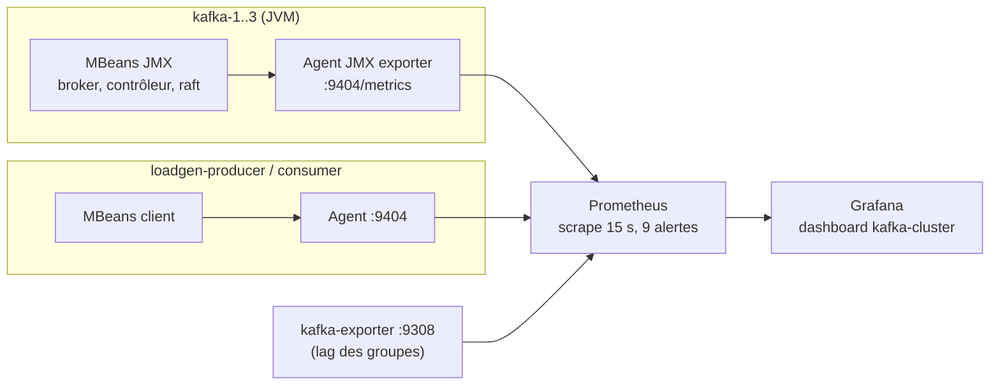

# Architecture du lab NovaShop

Ce document décrit le lab Docker Compose de la formation (livrable D) : composants, choix techniques, justification des compromis de laboratoire et différences avec une architecture de production.
Les références à la documentation pointent vers la documentation officielle d'Apache Kafka 4.3 (https://kafka.apache.org/43/).

## 1. Vue d'ensemble



| Bloc | Composants | Image |
|---|---|---|
| Cluster | `kafka-1..3`, `kafka-4` | `m0uaad/kafka-lab-kafka:4.3.2-1` (base Apache, Java 21, Alpine) |
| Administration | `tools`, `kafka-ui` | `m0uaad/kafka-lab-kafka:4.3.2-1`, `ghcr.io/kafbat/kafka-ui:v1.5.0` |
| Supervision | `prometheus`, `grafana`, `kafka-exporter`, agent JMX | `prom/prometheus:v3.15.1`, `grafana/grafana:13.2.4`, `danielqsj/kafka-exporter:v1.9.0`, `jmx_prometheus_javaagent` 1.7.0 |
| Charge | `loadgen-producer`, `loadgen-consumer` | `m0uaad/kafka-lab-kafka:4.3.2-1` (`kafka-producer-perf-test.sh`, `kafka-console-consumer.sh`) |
| Écosystème | `schema-registry`, `connect` | `confluentinc/cp-schema-registry:8.3.2`, `m0uaad/kafka-lab-kafka:4.3.2-1` (`connect-distributed.sh`) |
| Réplication entre clusters (TP9) | `kafka-cloud`, `mirrormaker` | `m0uaad/kafka-lab-kafka:4.3.2-1` (`kafka-server-start.sh`, `connect-mirror-maker.sh`) |

## 2. Versions retenues

Versions vérifiées le 27/10/2026 par téléchargement des images (`docker pull`) et exécution complète du lab.

| Composant | Version | Raison du choix |
|---|---|---|
| Apache Kafka | 4.3.2 | Dernier correctif de la ligne 4.3. La 4.4.0 (22/10/2026) est trop récente pour une formation : elle est seulement citée. |
| Confluent Schema Registry | 8.3.2 | Confluent Platform 8.3 embarque Kafka 4.3 (le client affiche `8.3.2-ccs`). |
| kafbat/kafka-ui | v1.5.0 | Fork maintenu de provectus/kafka-ui, qui n'est plus maintenu. |
| Prometheus | v3.15.1 | Ligne 3.x actuelle. |
| Grafana | 13.2.4 | Ligne actuelle ; le tableau de bord JSON est provisionné par fichier. |
| kafka-exporter | v1.9.0 | Lag des consumer groups. Lancé avec `--kafka.version=3.9.0` : la valeur par défaut correspond à un protocole retiré de Kafka 4 (KIP-896). Testé sur Kafka 4.3.2. |
| JMX exporter (agent Java) | 1.7.0 | Intégré à l’image Kafka par `build-images.sh`, empreinte SHA-256 contrôlée. |

L'image `apache/kafka:4.3.2` utilise Java 21. La documentation Kafka 4.3 supporte Java 17, 21 et 25, et recommande la dernière LTS (Java 25) en production (`operations/java-version`).

## 3. Les nœuds Kafka

### 3.1 Rôles combinés : un compromis de laboratoire

Chaque nœud `kafka-1..3` a `process.roles=broker,controller` : il héberge des partitions et participe au quorum KRaft.

| Critère | Lab : 3 nœuds combinés | Production : rôles séparés |
|---|---|---|
| Nombre de JVM | 3 (environ 2,1 Go de mémoire au total) | 3 ou 5 contrôleurs + N brokers |
| Isolation du contrôleur | Faible : une saturation du broker ralentit le contrôleur | Forte : le contrôleur ne sert aucun client |
| Redémarrage | Redémarrer un broker redémarre aussi un votant du quorum | Brokers et contrôleurs se redémarrent et se dimensionnent séparément |
| Pédagogie | Perte d'un nœud = 1 broker + 1 votant ; perte de 2 nœuds = plus de quorum (démo D4) | Même raisonnement, sur des machines distinctes |

La documentation officielle est explicite : « Combined mode is not recommended in critical deployment environments » et `process.roles` doit valoir `broker` ou `controller`, pas les deux (`operations/kraft`, Deploying Considerations).
Le lab utilise le mode combiné pour une seule raison : faire tenir un cluster tolérant à une panne sur un portable.

`kafka-4` est un broker seul (`process.roles=broker`). Il montre au TP7 qu'un broker rejoint un cluster existant sans faire partie du quorum : il y apparaît comme « Observer ».

### 3.2 Dimensionnement du quorum

- Le quorum compte 3 votants : il tolère 1 panne. Pour tolérer `N` pannes simultanées, il faut `2N + 1` contrôleurs, donc 3 ou 5 en pratique.
- La documentation estime suffisants, pour un cluster typique, 5 Go de mémoire et 5 Go de disque pour le journal de métadonnées d'un contrôleur.
- Comportement mesuré dans le lab avec 2 nœuds sur 3 arrêtés :
  - les opérations de métadonnées ne répondent plus, par exemple `describe --status` ou la création de topic, toutes deux sans réponse au bout de 45 s ;
  - la production `acks=1` et la consommation continuent sur les partitions dont le leader est le nœud survivant.

### 3.3 Quorum dynamique (KIP-853)

Le lab utilise le quorum dynamique, mode par défaut des nouvelles installations :

- `controller.quorum.bootstrap.servers=kafka-1:9093,kafka-2:9093,kafka-3:9093` dans chaque `server.properties`. Ce paramètre remplace `controller.quorum.voters`, propre au quorum statique.
- Chaque contrôleur est formaté avec la même liste de votants initiaux : `kafka-storage.sh format --initial-controllers "1@kafka-1:9093:<directory.id>,2@...,3@..."`.
- Le `directory.id` de chaque votant est fixé dans `docker-compose.yml`, et donc dans `env.template`, pour que le formatage soit reproductible.
- Un broker seul est formaté avec `--no-initial-controllers`.
- Résultat vérifié : `kafka-features.sh describe` affiche `kraft.version` à 1 et `metadata.version` à `4.3-IV0`.

Un cluster formaté en quorum statique (`controller.quorum.voters`) peut être passé en dynamique depuis Kafka 4.1 avec `kafka-features.sh upgrade --feature kraft.version=1`. Ce passage est irréversible (`operations/kraft`, documentation 4.1 et suivantes).

### 3.4 Démarrage d'un nœud

`config/kafka/common/start-node.sh`, intégré à l’image commune par `images/Dockerfile`, reproduit les deux gestes d'une installation sur serveur :

1. `kafka-storage.sh format --cluster-id $CLUSTER_ID --ignore-formatted`. L'option `--ignore-formatted` rend l'opération idempotente, et un répertoire ajouté à `log.dirs` est formaté au redémarrage suivant (TP7).
2. `kafka-server-start.sh /opt/lab/node/server.properties`.

Le lab n'utilise pas la conversion de variables d'environnement `KAFKA_*` de l'image officielle.
Les stagiaires lisent et modifient un vrai `server.properties` par nœud (`config/kafka/kafka-N/`), comme sur un serveur.
Une copie d'origine est conservée dans `config/kafka/pristine/` pour `reset.sh`.

L'agent JMX est ajouté à `KAFKA_OPTS` uniquement dans ce script, et non dans l'environnement du conteneur. Sinon, chaque outil lancé par `docker compose exec kafka-N kafka-xxx.sh` chargerait aussi l'agent et échouerait sur le port 9404 déjà occupé.

### 3.5 Mémoire et stockage

| Paramètre | Lab | Production (ordre de grandeur) |
|---|---|---|
| Heap JVM | 512 Mo (`-Xms512m -Xmx512m`) | 6 à 8 Go ; le reste de la RAM sert de cache de pages |
| Limite mémoire du conteneur | 1 Go (process mesuré : 700 Mo sous charge) | Pas de limite serrée : le cache de pages est essentiel aux performances |
| Données | Volume Docker `kafka-N-data` monté sur `/var/lib/kafka` | Disques dédiés (JBOD ou RAID 10), XFS ou ext4, `noatime` |
| `log.dirs` | `/var/lib/kafka/data` (TP7 : ajout de `/var/lib/kafka/data2`) | Un répertoire par disque |
| Métadonnées KRaft | Dans le premier `log.dirs` | `metadata.log.dir` sur un disque séparé, conseillé pour les contrôleurs |

### 3.6 Le cluster cloud et MirrorMaker 2 (TP9)

Le profil `mirror` ajoute un second cluster, `kafka-cloud`, qui joue le rôle d'un cluster géré dans le cloud (AWS MSK par exemple), et `mirrormaker`, un processus MirrorMaker 2 en mode dédié qui recopie les topics `orders` et `payments` du cluster `onprem` (`kafka-1` à `kafka-3`) vers `kafka-cloud`.

| Élément | Valeur |
|---|---|
| Identifiant du cluster cloud | `tF2HiBQuSD6MqpTGGGBVfA` (`CLOUD_CLUSTER_ID`) |
| Démarrage du nœud | `config/kafka/kafka-cloud/start-cloud.sh` : formatage `--standalone`, compte SCRAM `mm2` créé par `--add-scram` |
| Listeners | CONTROLLER `kafka-cloud:9093`, INTERNAL `kafka-cloud:19092` (outils), SECURE `kafka-cloud:9096` (SASL_SSL, SCRAM-SHA-512, port SASL/SCRAM de MSK) |
| Autorisation | `StandardAuthorizer`, aucun droit par défaut : le compte `mm2` reçoit ses ACL pendant le TP9 |
| Configuration de MM2 | `config/mirrormaker/mm2.properties` (copie d'origine dans `config/kafka/pristine/`) |
| Alias | `onprem` et `cloud` : `orders` devient `onprem.orders` (`DefaultReplicationPolicy`) |
| Topics internes | Tous sur le cluster cloud (`offset-syncs.topic.location=target`, heartbeats du sens inverse désactivés) : MM2 n'écrit rien sur la source |

`start-node.sh` est intégré à l'image : le nœud cloud a son propre script, monté depuis le lab, pour ne pas reconstruire l'image.

Comportements mesurés sur le lab (voir `TESTS.md`) :
- Sans ACL, MM2 s'arrête sur `TopicAuthorizationException` (`mm2-offsets.onprem.internal`), mais **le conteneur reste démarré**. `validate.sh` vérifie donc que les heartbeats du cluster cloud progressent, pas seulement que le conteneur tourne.
- En mode dédié, un sens désactivé émet quand même des heartbeats : sans `cloud->onprem.emit.heartbeats.enabled = false`, MM2 crée `heartbeats` et `mm2-*.cloud.internal` sur le cluster source.
- La traduction des offsets d'un groupe est exacte aux points de synchronisation seulement : après bascule, le groupe relit des messages déjà traités (au moins une fois, jamais de perte).

| Réglage | Lab | Production |
|---|---|---|
| Cluster cible | 1 nœud, RF 1 pour tous les topics, internes compris | 3 brokers ou plus sur 3 zones, RF 3 |
| Intervalles de synchronisation (offsets, configurations, topics) | 5 à 10 s | Défauts (60 s, 10 min, 10 min), à ajuster selon le besoin de bascule |
| ACL de `mm2` | Préfixes `onprem.` et `mm2-`, topic `heartbeats`, tous les groupes | Idem, groupes limités aux applications à basculer |
| Mot de passe `mm2` | `mm2-secret` en clair dans `mm2.properties` | Secret externalisé (config provider, gestionnaire de secrets) |
| Authentification vers MSK | SCRAM | SCRAM ou IAM (`aws-msk-iam-auth`, non testé dans le lab) |

## 4. Listeners



| Listener | Port | Protocole | Adresse annoncée | Usage |
|---|---|---|---|---|
| `CONTROLLER` | 9093 | PLAINTEXT | `kafka-N:9093` | Quorum KRaft. Non publié sur l'hôte. |
| `INTERNAL` | 19092 | PLAINTEXT | `kafka-N:19092` | Réplication entre brokers (`inter.broker.listener.name`), outils, UI, supervision |
| `EXTERNAL` | 9092, 9192, 9292, 9392 | PLAINTEXT | `localhost:<port>` | Clients lancés sur l'hôte |
| `SECURE` | 19094 | SASL_SSL, SCRAM-SHA-512 | `kafka-N:19094` | TP5 : TLS, authentification, ACL, quotas |

Chaque nœud publie un port EXTERNAL différent : un client sur l'hôte reçoit `localhost:9092`, `localhost:9192` et `localhost:9292` dans les métadonnées et doit pouvoir joindre chacune de ces adresses.

Les deux cas suivants ont été vérifiés et servent de démonstration D2 :

- un client lancé sur l'hôte (tarball Kafka 4.3.2, Java 21) se connecte à `localhost:9092` et produit et consomme normalement ;
- un client lancé dans un conteneur hors du réseau `kafka-lab`, avec `host.docker.internal:9092`, obtient les métadonnées puis échoue : `Connection to node 2 (localhost/127.0.0.1:9192) could not be established`. L'adresse annoncée `localhost` désigne le conteneur client lui-même.

En production, chaque listener est authentifié et chiffré selon sa zone réseau. Le listener du contrôleur est lui aussi protégé, par exemple en SSL avec authentification mutuelle.

## 5. Sécurité

La sécurité est configurée dès le démarrage mais reste sans effet jusqu'au TP5. Les TP1 à TP4 fonctionnent donc sans identifiants.

| Élément | Configuration du lab | Écart avec la production |
|---|---|---|
| Autorisation | `StandardAuthorizer` (ACL stockées dans les métadonnées KRaft), `allow.everyone.if.no.acl.found=false` | Identique |
| Super-utilisateurs | `User:admin;User:ANONYMOUS` | **ANONYMOUS ne doit jamais être super-utilisateur.** Ici, il permet aux listeners PLAINTEXT de rester utilisables par les outils pendant toute la formation. |
| Listener SECURE | SASL_SSL, mécanisme SCRAM-SHA-512 seul | Identique dans le principe |
| Listeners INTERNAL et EXTERNAL | PLAINTEXT sans authentification | Tous les listeners authentifiés ; réplication en SSL ou SASL_SSL |
| Certificats | CA de lab générée par `keytool` (`security/generate-certs.sh`), keystores PKCS12 avec SAN `kafka-N` et `localhost`, mot de passe `novashop-lab` | PKI de l'entreprise, secrets hors des fichiers (`config.providers`, coffre-fort), rotation |
| Authentification du client par certificat | `ssl.client.auth=none` ; keystore `client-alice` prêt pour la variante mTLS | Selon la politique : mTLS ou SASL |
| Identifiants SCRAM | Créés au TP5 avec `kafka-configs.sh --entity-type users` | Identique, mots de passe gérés hors des scripts |
| Grafana | Consultation anonyme (rôle Viewer), admin / kafka-lab | Authentification SSO, pas d'accès anonyme |

Un refus d'autorisation est tracé dans `/opt/kafka/logs/kafka-authorizer.log`, avec la mention `Denied` et la règle `DefaultDeny`.

## 6. Observabilité



- **Règles JMX** : `monitoring/jmx-exporter/kafka-broker.yml` couvre les métriques broker, contrôleur, raft, requêtes, quotas et JVM. `kafka-client.yml` couvre les producteurs et consommateurs Java.
- **Collecte** : `monitoring/prometheus/prometheus.yml` définit les jobs `kafka`, `kafka-scale` (pour `kafka-4`, normalement absent), `kafka-clients`, `kafka-exporter` et `prometheus`. Le label `instance` vaut le nom du nœud, sans le port.
- **Alertes** : `monitoring/prometheus/rules/kafka-alerts.yml` définit 9 règles.

| Alerte | Condition | Délai |
|---|---|---|
| `KafkaNodeDown` | cible `kafka` injoignable | 30 s |
| `KafkaNoActiveController` | somme des contrôleurs actifs différente de 1 | 30 s |
| `KafkaOfflinePartitions` | partitions sans leader | immédiat |
| `KafkaUnderMinIsrPartitions` | partitions sous `min.insync.replicas` | 30 s |
| `KafkaUnderReplicatedPartitions` | URP > 0 | 1 min |
| `KafkaFencedBrokers` | brokers isolés par le contrôleur | 1 min |
| `KafkaRequestHandlerSaturated` | threads de traitement inactifs moins de 30 % du temps | 5 min |
| `KafkaBrokerLogSizeHigh` | données d'un nœud > 250 Mo (seuil de lab) | 1 min |
| `KafkaConsumerGroupLagHigh` | lag d'un groupe sur un topic > 5000 messages | 1 min |

Les délais ci-dessus reprennent le champ `for` de chaque règle. Le fichier de règles fait foi.

- **Tableau de bord** : `monitoring/grafana/dashboards/kafka-cluster.json` (uid `kafka-cluster`), 34 panneaux répartis en rangées Santé, Débit, Réplication, Requêtes, Consommateurs, Stockage et Quorum KRaft.
- **Traces** : `config/kafka/common/log4j2.yaml` reprend la configuration livrée avec Kafka 4.3.2, plus `monitorInterval: 30`. Une modification du fichier est appliquée en 30 s environ sur les 3 nœuds (mesuré : 32 s). Les fichiers produits sont `server.log`, `controller.log`, `state-change.log`, `kafka-request.log`, `log-cleaner.log` et `kafka-authorizer.log`.
- Kafka UI n'affiche pas de métriques de débit : ses colonnes attendent des noms de métriques différents de ceux produits par nos règles. Les métriques sont dans Grafana.

En production, il faut ajouter les métriques système (node_exporter : disque, réseau, CPU), une alerte sur l'espace disque en pourcentage plutôt qu'en valeur absolue, et l'acheminement des alertes (Alertmanager vers la messagerie ou l'astreinte). Le lab n'inclut pas Alertmanager : les alertes se lisent dans Prometheus et Grafana.

## 7. Profils et modes

| Mode (`scripts/start.sh`) | Profils Compose | Services | Mémoire mesurée |
|---|---|---|---|
| `core` | aucun | kafka-1..3, tools, kafka-ui | 1,5 Go |
| `extended` | `monitoring`, `load` | + prometheus, grafana, kafka-exporter, loadgen-producer, loadgen-consumer | 4,1 Go |
| `full` | `monitoring`, `load`, `ecosystem` | + schema-registry, connect | 4,9 Go |
| (TP7) | `scale` | + kafka-4 | + 0,4 à 0,8 Go |
| (TP9) | `mirror` | + kafka-cloud, mirrormaker | + 1,0 Go (0,6 et 0,4 Go) |

## 8. Réglages propres au lab

Chaque réglage marqué `[LAB]` dans les fichiers de configuration accélère une démonstration ou réduit l'empreinte du lab. Il ne doit pas être repris tel quel.

| Réglage | Valeur du lab | Défaut Kafka 4.3 | Raison |
|---|---|---|---|
| `log.retention.check.interval.ms` | 30 000 | 300 000 | Voir la rétention agir pendant le TP3 |
| `group.initial.rebalance.delay.ms` | 0 | 3 000 | Groupes immédiatement actifs dans les TP |
| `auto.create.topics.enable` | false | true | Bonne pratique de production, gardée volontairement |
| `num.partitions` / `default.replication.factor` | 3 / 3 | 1 / 1 | Topics répliqués par défaut |
| `min.insync.replicas` | 1 (défaut), passé à 2 au niveau cluster au TP4 | 1 | Voir l'encadré ci-dessous |
| Heap | 512 Mo | 1 Go (script de démarrage) | Portable |
| `KafkaBrokerLogSizeHigh` | 250 Mo | sans objet | Déclenchable par l'incident 6 |
| `super.users` | inclut ANONYMOUS | sans objet | Listeners PLAINTEXT utilisables par les outils |

**Pourquoi `min.insync.replicas` n'est pas dans `server.properties`.**
Depuis Kafka 4.1, les nouveaux clusters activent les Eligible Leader Replicas (ELR, KIP-966). Avec l'ELR, un `min.insync.replicas` au niveau d'un broker est refusé :

```
Broker-level min.insync.replicas cannot be altered while ELR is enabled
```

La valeur se fixe au niveau du cluster (`kafka-configs.sh --alter --entity-type brokers --entity-default`) ou du topic. C'est la démarche du TP4.

## 9. Scripts

| Script | Rôle |
|---|---|
| `prepare.sh [--no-pull]` | Prérequis, images préconstruites, certificats locaux |
| `start.sh core\|extended\|full` | Démarrage avec attente des healthchecks (4 min maximum) |
| `stop.sh [--down]` | Arrêt sans perte de données |
| `reset.sh [--yes]` | Suppression des volumes, restauration des configurations d'origine |
| `validate.sh` | Contrôle de l'environnement (code retour = nombre d'échecs) |
| `selftest.sh [tp1 ... tp7 tp9]` | Rejoue les commandes clés des TP (109 vérifications, dont 12 pour le TP9) |
| `incident.sh <n> inject\|status\|repair` | Six incidents pour le TP8 |
| `offline-bundle.sh save\|load` | Lot hors ligne d'images |
| `final/prepare-final.sh`, `final/check-final.sh` | TP final : état dégradé et notation automatique |

## 10. Références

- Documentation Apache Kafka 4.3 : https://kafka.apache.org/43/
  - KRaft, déploiement et quorum dynamique : https://kafka.apache.org/43/operations/kraft/
  - Eligible Leader Replicas : https://kafka.apache.org/43/operations/eligible-leader-replicas/
  - Notes de mise à jour 4.0 à 4.3 : https://kafka.apache.org/43/getting-started/upgrade/
  - Sécurité : https://kafka.apache.org/43/security/
- Image Docker officielle : https://hub.docker.com/r/apache/kafka
- Prometheus JMX exporter : https://github.com/prometheus/jmx_exporter
- kafbat/kafka-ui : https://github.com/kafbat/kafka-ui
- kafka-exporter : https://github.com/danielqsj/kafka_exporter
- Confluent Schema Registry : https://docs.confluent.io/platform/current/schema-registry/
